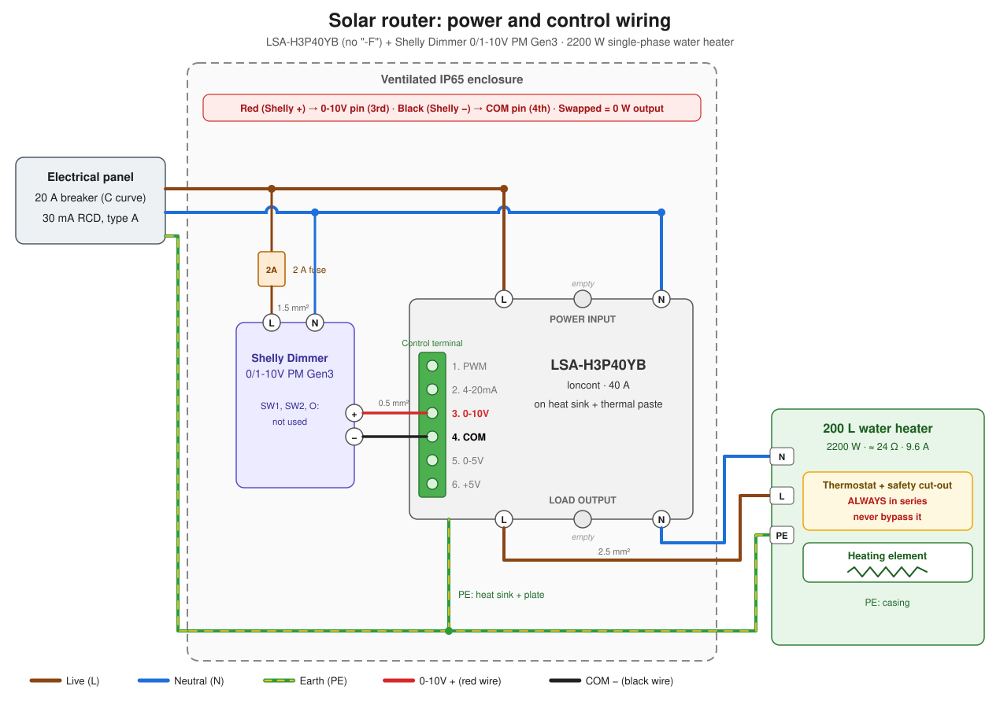
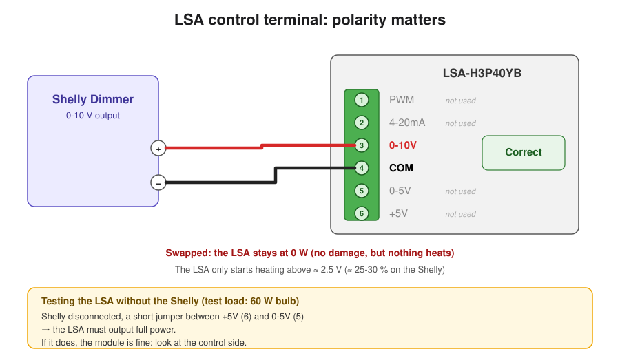

# 🌞 Home Assistant solar diverter

[🇫🇷 Français](README.md) · **🇬🇧 English**

Heat the water tank with solar surplus, power modulated from 0 to 2200 W, driven by Home Assistant.

## Parts

| Part | Purpose |
|---|---|
| **LSA-H3P40YB** 40 A, version **without "-F"** | Power regulator |
| **Shelly Dimmer 0/1-10V PM Gen3** | 0-10 V control of the LSA, driven over Wi-Fi by HA |
| Aluminium heat sink (LCTC H-110) + thermal paste | LSA cooling |
| IP65 enclosure, depth ≥ 150 mm, with vents | Protection |
| 2 A fuse | Shelly protection |
| Grid metering (ZLinky TIC or Shelly Pro EM) | Surplus seen by HA |
| 20 A breaker + 30 mA type A RCD, 2.5 mm² cable | Water heater circuit |

⚠️ The **LSA-H3P40YB-F** version does not work with an external command.

## Wiring

## Photos

<table>
  <tr>
    <td align="center"> <em>Test build on a board</em></td>
    <td align="center"> <em>Final build</em></td>
  </tr>
</table>

## Settings

- Shelly: **1-10V** mode, min brightness on toggle **0**.
- The LSA only heats between **~30 % and 90 %** on the Shelly (≈ 100 W to 2200 W).
- HA regulation: every 20 s, adjust the Shelly to keep ~200 W of export. Starting point: [Mathieu Carbou's YaSolR](https://yasolr.carbou.me/blog/2024-07-01_shelly_solar_diverter).

## Safety

- Work with power off. Water heater thermostat **always in series**, never bypassed.
- Earth on the water heater and the LSA heat sink.
- The LSA has no thermal protection: heat sink and ventilated enclosure required.
- Test with a 60 W incandescent bulb first.
