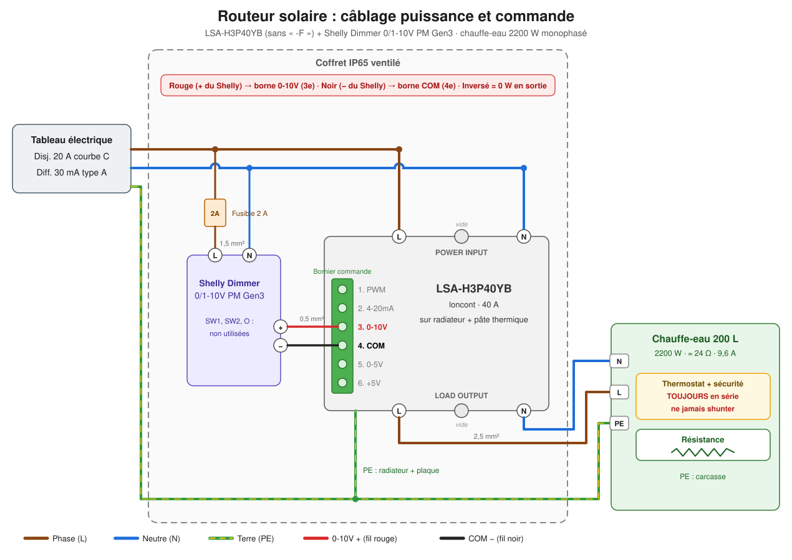
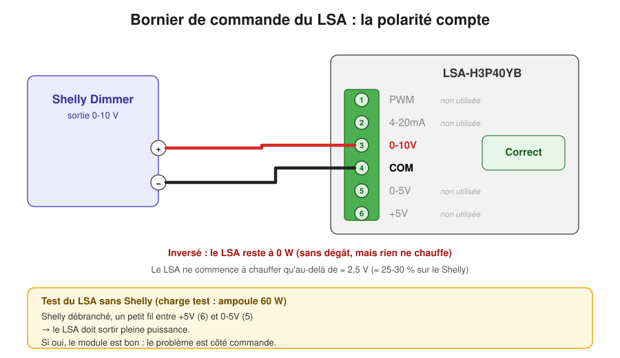
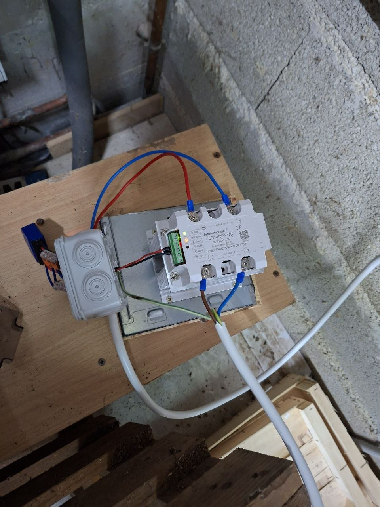
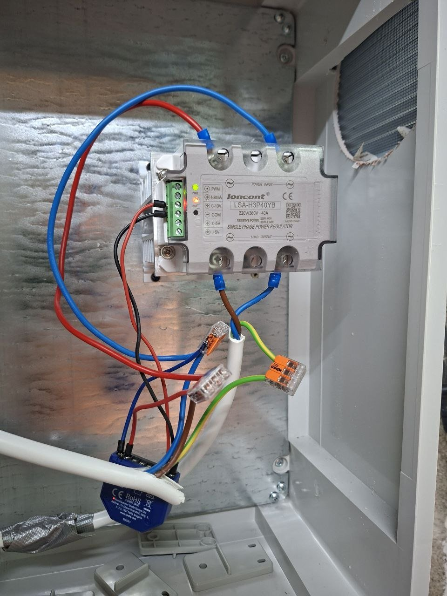

# 🌞 Routeur solaire Home Assistant

**🇫🇷 Français** · [🇬🇧 English](README.en.md)

Chauffer le ballon d'eau chaude avec le surplus solaire, puissance modulée de 0 à 2200 W, pilotée par Home Assistant.

## Matériel

| Composant | Rôle |
|---|---|
| **LSA-H3P40YB** 40 A, version **sans « -F »** | Régulateur de puissance |
| **Shelly Dimmer 0/1-10V PM Gen3** | Commande 0-10 V du LSA, piloté en Wi-Fi par HA |
| Radiateur alu (LCTC H-110) + pâte thermique | Refroidissement du LSA |
| Coffret IP65, profondeur ≥ 150 mm, avec grilles d'aération | Protection |
| Fusible 2 A | Protection du Shelly |
| Mesure réseau (ZLinky TIC ou Shelly Pro EM) | Surplus vu par HA |
| Disjoncteur 20 A + différentiel 30 mA type A, câble 2,5 mm² | Circuit du ballon d'eau chaude |

⚠️ La version **LSA-H3P40YB-F** ne fonctionne pas avec une commande externe.

## Schéma

## Photos

<table>
  <tr>
    <td align="center"> <em>Essai sur planche</em></td>
    <td align="center"> <em>Montage final</em></td>
  </tr>
</table>

## Réglages

- Shelly : mode **1-10V**, min brightness on toggle **0**.
- Le LSA ne chauffe qu'entre **~30 % et 90 %** du Shelly (≈ 100 W à 2200 W).
- Régulation HA : toutes les 20 s, ajuster le Shelly pour garder ~200 W d'injection. Point de départ : [YaSolR de Mathieu Carbou](https://yasolr.carbou.me/blog/2024-07-01_shelly_solar_diverter).

## Sécurité

- Travail hors tension. Thermostat du ballon d'eau chaude **toujours en série**, jamais shunté.
- Terre sur le ballon d'eau chaude et le radiateur du LSA.
- Le LSA n'a pas de protection thermique : radiateur et coffret ventilé obligatoires.
- Test d'abord avec une ampoule à filament 60 W.
